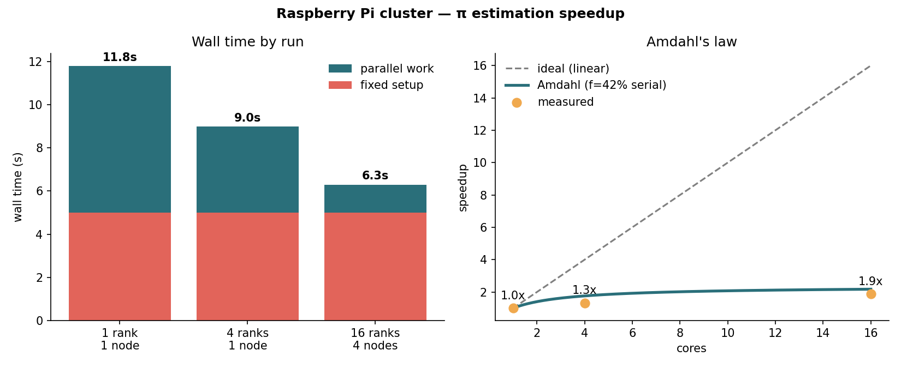

# Monte Carlo π — Amdahl's Law on the Cluster

Estimates π by throwing random darts at a square and counting how many land
inside the quarter-circle (a fraction of π/4 of them). It's a simple
embarrassingly parallel job, but with a twist: **every run has a fixed
5-second setup step that can't be parallelised.** That shows
[Amdahl's law](https://en.wikipedia.org/wiki/Amdahl%27s_law): the serial part
of a program limits how much faster more cores can make it.



---

## How it works (`pi_montecarlo.py`)

1. **Serial setup (5 s).** One rank per node keeps one core busy for 5 seconds,
   standing in for work a real program must do before it can split up (reading
   input, building data structures). All nodes do this at the same time, so it
   always costs 5 s of wall time, however many cores you use.
2. **Parallel part.** The fixed total of **120 million** random points is split
   evenly across the ranks. Each rank generates its share in batches of 2
   million (to limit memory use) with its own random stream, and counts the hits.
3. **Combine.** `MPI.reduce` sums the hits on rank 0, which prints
   `π ≈ 4 × hits / total`.

Waiting ranks use a sleeping `Ibarrier` instead of the busy-waiting
`MPI.Barrier`, so idle cores really are idle. This keeps the CPU LEDs and
monitoring honest.

---

## Results

| Run | Ranks | Nodes | π estimate | Serial | Compute | **Wall time** | Speedup |
|---|---|---|---|---|---|---|---|
| `pi-1rank-210` | 1 | 1 | 3.141420 | 5.0 s | 6.9 s | **11.9 s** | 1.00× |
| `pi-4rank-211` | 4 | 1 | 3.141400 | 5.0 s | 4.1 s | **9.1 s** | 1.31× |
| `pi-16rank-212` | 16 | 4 | 3.141295 | 5.1 s | 1.3 s | **6.4 s** | 1.86× |

### What this shows

- **Amdahl's law.** The serial step is 5.0 of 11.9 s, which is **42 %** of
  the 1-core run. Even with infinite cores the run can't take less than 5 s,
  so the best possible speedup is 11.9 ÷ 5 ≈ **2.4×**. 16 cores got 1.86×,
  close to what Amdahl's law predicts (see the chart).
- **The parallel part does speed up.** Compute time falls from 6.9 s to 1.3 s,
  which is **5.3×** on 16 cores.
- **4 cores on one Pi only gave 1.7× on the compute part.** Generating random
  numbers with NumPy moves a lot of data through memory, and one core can
  already use most of a Pi's memory bandwidth (see [`../stream`](../stream)).
  Spreading the ranks over 4 Pis gives 4 times the memory bandwidth, which is
  why 16 ranks on 4 nodes do much better.
- All estimates are within 0.0003 of π (3.141593). With 120 million samples,
  the expected random error is about ±0.00015.

---

## Files

| File | Role |
|---|---|
| `pi_montecarlo.py` | The MPI program (`mpi4py` + `numpy`) |
| `pi_1rank.sh`, `pi_2rank.sh`, `pi_4rank.sh` | SLURM scripts: 1, 2 or 4 ranks on one node |
| `pi_16rank.sh` | SLURM script: 16 ranks on 4 nodes (4 per node) |
| `pi-*.out` | Results from the runs above |
| `plot_speedup.py` | Reads the newest `.out` files and draws `speedup.png` (needs matplotlib) |
| `plot_speedup.sh` | Prints the same comparison as a coloured text chart in the terminal |
| `speedup.png` | The chart above (from an earlier set of runs, so the times differ by about 0.1 s) |

---

## How to run it

Install the dependencies on every node:

```bash
sudo apt update && sudo apt install -y openmpi-bin python3-numpy python3-mpi4py
```

Submit the runs:

```bash
sbatch /clusterfs/pi/pi_1rank.sh
```

```bash
sbatch /clusterfs/pi/pi_4rank.sh
```

```bash
sbatch /clusterfs/pi/pi_16rank.sh
```

When they've finished (check with `squeue`), compare them in the terminal:

```bash
bash /clusterfs/pi/plot_speedup.sh
```

Or redraw the chart (on the login node):

```bash
sudo apt install -y python3-matplotlib && python3 /clusterfs/pi/plot_speedup.py
```

To run by hand with a different number of samples:

```bash
cd /clusterfs/pi && mpirun -n 4 python3 pi_montecarlo.py 500000000
```

**Things to try:**
- Raise the sample count so the parallel part dominates, and watch the speedup
  get closer to linear.
- Change `SERIAL_WORK` in `pi_montecarlo.py` to see how the serial fraction
  caps the speedup.
- `pi_2rank.sh` exists but hasn't been run yet. Run it to add a 2-core point.
  (The plot scripts currently only chart the 1, 4 and 16 rank runs.)
